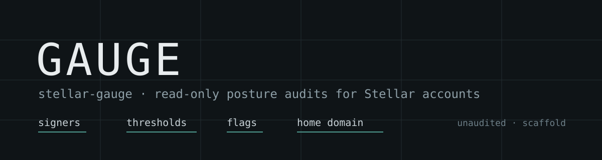

<p align="center">
  
</p>

<p align="center">
  <a href="https://github.com/posture-sec/guage/actions/workflows/ci.yml"></a>
  <a href="https://github.com/posture-sec/guage/actions/workflows/roadmap-check.yml"></a>
  <a href="https://scorecard.dev/viewer/?uri=github.com/posture-sec/guage"></a>
  
  
  <a href="SECURITY.md#status-of-this-code"></a>
  <a href="ROADMAP.md"></a>
</p>

# Gauge

**Working name Gauge, binary `stellar-gauge`.** It reads the public configuration of your Stellar accounts and compares it with what you said you expect. Signers, thresholds, flags, home domain. It reports the difference and exits nonzero when the difference matters, so a scheduled run in CI catches a change to a treasury or issuer account the day it happens instead of the day it costs something.

The problem it addresses: an account's control settings live on-chain, are public, and almost nobody reviews them. A signer added during an incident stays forever. A threshold that no longer matches the key layout makes a "2-of-3" account 1-of-1. A clawback flag appears without anyone declaring it. These are configuration facts, so they are checkable without touching a private key.

Gauge is read-only and secret-free. It never accepts, stores or echoes a secret seed, never builds or submits a transaction, and treats every value it fetches as hostile input.

## Status

Functional alpha (ROADMAP Phase 2, tasks 2.1 to 2.10). The policy loader, Horizon client, report renderers, orchestrator and CLI are implemented and tested:

```bash
go run ./cmd/stellar-gauge version
go run ./cmd/stellar-gauge check --network testnet --endpoint https://horizon-testnet.stellar.org G...
```

A run reads the account, prints what the chain shows and exits `0`, `2` or `3`. No audit rule is registered yet, so it cannot emit a finding or exit `1`; that arrives with Phase 3. There is no release to install.

## What it will check

Sixteen rules in v0.1, each with a stable kebab-case ID. Severity depends on the account's declared role (issuer and treasury are held to a tighter bar than merchant and distribution).

| Family | Rules |
| --- | --- |
| Account | `acct-missing`, `acct-network-mismatch` |
| Signers | `sig-no-signing-weight`, `sig-threshold-unreachable`, `sig-threshold-order`, `sig-single-key-high`, `sig-hashx`, `sig-unexpected-signer`, `sig-missing-expected`, `sig-weight-drift` |
| Thresholds and flags | `thr-drift`, `flag-drift`, `flag-undeclared-clawback` |
| Identity | `id-no-home-domain`, `id-toml-unreachable`, `id-toml-account-unlisted` |

Exit codes: `0` pass, `1` findings at or above `--fail-on`, `2` configuration or usage error, `3` source or internal error. Anything unreachable, oversized, malformed or ambiguous fails closed. It never exits 0 on a check it could not complete.

## What this does not check

- Key custody. On-chain data cannot show who holds a key, how it is stored, or whether it leaked.
- Whether an account is a good account. Gauge reports posture against your declared expectations. It never says an account is secure or safe, and "no findings" is not a clean bill of health.
- Transactions, balances, offers, claimable balances, liquidity pools and Soroban contract accounts.
- Live streaming or alerting. It is a state comparison you schedule, not a daemon.
- The expectations themselves. If an attacker can edit both `gauge.toml` and the workflow that runs Gauge, the check can be made to pass. That residual risk is documented in `ARCHITECTURE_ESSENTIALS.md` section 10 and is a process problem, not a code problem.

## Usage

```bash
stellar-gauge check --network testnet --endpoint https://horizon-testnet.stellar.org G... G...
stellar-gauge audit --config gauge.toml --format json
stellar-gauge version
```

`check` takes accounts on the command line and needs an explicit network and one endpoint. `audit` reads accounts, roles and expectations from the policy file, whose `endpoints` entry supplies the endpoint. Both take `--format text|json` and `--fail-on high|warn`; markdown output is not implemented yet.

`gauge.example.toml` shows the policy shape: one `[[account]]` block per audited account with its role and expected signers, thresholds and flags, plus `[[accept]]` entries for risks you have decided to live with. An omitted expectation is not a zero or a false; it means "not declared", and drift rules only fire where you declared something.

## How it works

```
policy loader + Source + sep1 -> snapshots -> rules -> accept filter -> report -> exit code
```

| Package | Responsibility |
| --- | --- |
| `internal/model` | Shared types: snapshots, findings, reports, severities |
| `internal/strkey` | Address classification and secret-seed rejection |
| `internal/threshold` | Authorization math: reachability and minimum signers |
| `internal/sanitize` | Strips control, bidi and zero-width characters from chain data |
| `internal/policy` | Strict `gauge.toml` decode, roles, accepted risks |
| `internal/source` | Horizon client behind a `Source` interface |
| `internal/sep1` | Guarded `stellar.toml` fetch for identity rules |
| `internal/rules` | Pure rule functions, no I/O |
| `internal/report` | Text and JSON renderers, exit-code mapping |
| `internal/run` | Orchestration |

Imports point one way: `model <- strkey, threshold, sanitize <- policy, source, sep1 <- rules <- report <- run <- cmd`. Dependencies: Go standard library plus one TOML parser. No framework, no plugin system, no rule language.

## Documentation

- `PRD.md`: scope, users, requirements
- `ARCHITECTURE.md`: design, data models, decision records, red-team review
- `ARCHITECTURE_ESSENTIALS.md`: the hard rules an agent must not break
- `ROADMAP.md`: every remaining task, progress and changelog
- `project_structure.md`: where files go and who may change them
- `AGENTS.md`: working agreement for coding agents

## Maintainers

| Maintainer | GitHub | Contact |
| --- | --- | --- |
| Ademola | [@bolabeatz](https://github.com/bolabeatz) | [GitHub Discussions](https://github.com/posture-sec/guage/discussions) |

## Contributing

Read `CONTRIBUTING.md`. Every pull request updates `ROADMAP.md` in the same change, and every rule ships with a positive and a negative fixture.

<p align="center">
  <a href="https://github.com/posture-sec/guage/graphs/contributors">
    
  </a>
</p>

## License

Apache-2.0. See `LICENSE`. This code is unaudited; see `SECURITY.md`.
