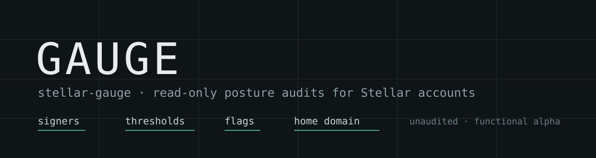

<p align="center">
  
</p>

<p align="center">
  <a href="https://github.com/posture-sec/guage/actions/workflows/ci.yml"></a>
  <a href="https://github.com/posture-sec/guage/actions/workflows/roadmap-check.yml"></a>
  <a href="https://scorecard.dev/viewer/?uri=github.com/posture-sec/guage"></a>
  <a href="https://github.com/posture-sec/guage/actions"></a>
  <a href="#what-it-checks"></a>
  <a href="https://posture-sec.github.io/guage/"></a>
  
  
  <a href="SECURITY.md#status-of-this-code"></a>
  <a href="ROADMAP.md"></a>
</p>

# Gauge

**Gauge (binary `stellar-gauge`)** reads the public configuration of your Stellar accounts and compares it with what you said you expect. Signers, thresholds, flags, home domain. It reports the difference and exits nonzero when the difference matters, so a scheduled run in CI catches a change to a treasury or issuer account the day it happens instead of the day it costs something.

[Documentation site](https://posture-sec.github.io/guage/) · [Quick start](#usage) · [What it checks](#what-it-checks) · [Security](SECURITY.md) · [Contributing](CONTRIBUTING.md)

The problem it addresses: an account's control settings live on-chain, are public, and almost nobody reviews them. A signer added during an incident stays forever. A threshold that no longer matches the key layout makes a "2-of-3" account 1-of-1. A clawback flag appears without anyone declaring it. These are configuration facts, so they are checkable without touching a private key.

Gauge is read-only and secret-free. It never accepts, stores or echoes a secret seed, never builds or submits a transaction, and treats every value it fetches as hostile input.

## Status

<!-- METRICS:START -->
| Indicator | Value | Source |
|---|---|---|
| Unit & Integration Tests | **200 passing** | `go test ./...` |
| Posture Rules | **16 verified** across 4 families | `internal/rules` |
| Binary | **`stellar-gauge`** | `cmd/stellar-gauge` |
| Security Guarantee | **Read-only / 0 secret keys** | Architecture spec |
<!-- METRICS:END -->

Functional alpha (ROADMAP Phase 2, tasks 2.1 to 2.11), with Phase 3 complete on 2026-11-05: the sixteen rules, the role profiles and the facts report. The policy loader, Horizon client, guarded `stellar.toml` fetcher, report renderers, orchestrator, rules and CLI are implemented and tested:

```bash
go run ./cmd/stellar-gauge version
go run ./cmd/stellar-gauge check --network testnet --endpoint https://horizon-testnet.stellar.org G...
```

A run reads the account, prints what the chain shows and exits `0`, `1`, `2` or `3`. A missing account or an endpoint on the wrong network is a HIGH finding and exits `1` by default, as does any run that could not complete. Declared flag drift, an undeclared clawback and a home domain whose `stellar.toml` cannot be read are warnings and exit `1` under `--fail-on warn`. A run also fetches the `stellar.toml` of any account that publishes a home domain, through a guard that resolves the name and then refuses loopback, private, link-local and other non-public addresses at dial time; an identity Gauge could not verify is a warning, never a pass. An account with no standing signing weight, a threshold tier its signers can never reach and a signer the policy does not declare are HIGH findings too, and an unreachable tier cannot be accepted away. What a finding is worth depends on the role you declared for the account: an issuer or treasury is held to a tighter bar than a distribution account or a merchant, a role can only raise a severity and never lower one, and `check`, which declares no role, reports at the baseline. There is no release to install.

Ahead of every finding, a report prints the facts it read for that account: thresholds, how many of the account's own signers each tier needs, flags, home domain, sponsor, each signer, what your policy declared (or that it declared nothing, which is what a `check` run did) and what the identity fetch saw, including the step that decided it. Those lines carry no severity and cannot fail a run; they are what makes "no findings" readable as an observation rather than a verdict.

A 7-page documentation site is published at **[https://posture-sec.github.io/guage/](https://posture-sec.github.io/guage/)**, covering policy specifications, CLI mechanics, integration guides, and an interactive rule reference.

## What it checks

Sixteen rules in v0.1, each with a stable kebab-case ID, and all sixteen are implemented: the account, flag and identity families from tasks 3.2, 3.3 and 3.5, and the nine signer and threshold rules from task 3.1 (`sig-no-signing-weight`, `sig-threshold-unreachable`, `sig-threshold-order`, `sig-single-key-high`, `sig-hashx`, `sig-unexpected-signer`, `sig-missing-expected`, `sig-weight-drift`, `thr-drift`). Severity depends on the account's declared role (PRD Appendix A, applied by task 3.4): single-key control is HIGH for an issuer or treasury and INFO for an account with no role, drift is HIGH for a treasury, and an issuer that publishes no home domain is a finding whether or not a policy asked it to.

| Family | Rules |
| --- | --- |
| Account | `acct-missing`, `acct-network-mismatch` |
| Signers | `sig-no-signing-weight`, `sig-threshold-unreachable`, `sig-threshold-order`, `sig-single-key-high`, `sig-hashx`, `sig-unexpected-signer`, `sig-missing-expected`, `sig-weight-drift` |
| Thresholds and flags | `thr-drift`, `flag-drift`, `flag-undeclared-clawback` |
| Identity | `id-no-home-domain`, `id-toml-unreachable`, `id-toml-account-unlisted` |

Exit codes: `0` pass, `1` findings at or above `--fail-on`, `2` configuration or usage error, `3` source or internal error. Anything unreachable, oversized, malformed or ambiguous fails closed. It never exits 0 on a check it could not complete.

## What this does not check

- Key custody. On-chain data cannot show who holds a key, how it is stored, or whether it leaked.
- Whether an account is a good account. Gauge reports posture against your declared expectations. It never says an account is secure or safe, and "no findings" is not a clean bill of health.
- What is still unwritten rather than still unchecked. All sixteen v0.1 rules are registered and every expectation kind in `gauge.example.toml` is compared by at least one rule, so the gaps are in the surfaces around them: markdown output (`--format markdown` refuses rather than falling back, task 5.3), `snapshot` and `diff` against a saved baseline (5.2, and the `--out` flag those commands would need does not exist), trustline exposure facts for the assets an account holds (5.5), the SEP-29 memo-required check for a merchant receiving account (5.6) and comparison across two endpoints (5.1). This bullet is about what is unfinished; the two above are about what Gauge will not look at either way.
- Whether the rules are right about your account. Eighteen Appendix B scenarios, each pinned as a text report and a JSON report, prove the report does not change shape under a test, and no operator outside this repository has read a finding from it yet, which is task 4.1 and gate G4. A finding that matches your configuration is a judgement you should still review the first time, not a verdict the tool has earned.
- Transactions, balances, offers, claimable balances, liquidity pools and Soroban contract accounts.
- Live streaming or alerting. It is a state comparison you schedule, not a daemon.
- The expectations themselves. If an attacker can edit both `gauge.toml` and the workflow that runs Gauge, the check can be made to pass. That residual risk is documented in `ARCHITECTURE_ESSENTIALS.md` section 10 and is a process problem, not a code problem.

Those seven bullets are the expansion of one sentence every report ends with, whether the run passed or failed. In a text report it is the last line, after the exit code:

```text
limits: Gauge reads public ledger state only. It cannot see who holds a key, whether signers are separate people, or off-chain controls. A clean report is a posture result, not proof that the account cannot be compromised.
```

It is a constant in `internal/report`, so the footer in a report and the disclaimer in this file are one sentence rather than two that can drift. It is in the JSON output too, under `limits`, and a run that exits `0` prints it just as a run that exits `1` does.

## Usage

There is no release to install, so the binary comes from the repository:

```bash
git clone https://github.com/posture-sec/guage
cd guage
go build -o stellar-gauge ./cmd/stellar-gauge
```

Then, with that binary on your `PATH` or run as `./stellar-gauge`:

```bash
stellar-gauge check --network testnet --endpoint https://horizon-testnet.stellar.org G... G...
stellar-gauge audit --config gauge.toml --format json
stellar-gauge version
```

`go run ./cmd/stellar-gauge ...` is the same code without the build step, which is fine for one account and slower than a cached binary on a schedule.

`check` takes accounts on the command line and needs an explicit network and one endpoint. Neither has a default, and the usage error names both public endpoints so there is one thing to read: a silent default to mainnet is how an audit ends up reading the wrong ledger. `audit` reads accounts, roles and expectations from the policy file, whose `endpoints` entry supplies the endpoint; run it with no `gauge.toml` and it tells you to copy `gauge.example.toml`. Both take `--format text|json` and `--fail-on high|warn`; markdown output is not implemented yet.

A text report reads facts first, then judgements. This is the whole output of one `check` against a fresh testnet account, pasted as the binary printed it on 2026-11-05 at ledger 5570026, with nothing elided:

```text
Gauge 0.1.0-dev
network: Test SDF Network ; September 2015
ledger: 5570026

account GBK4NFJ7SVMUNPBIYBC4WNMCTKI6Z66MYYWZQSSLQNOSUSTMKVUKE7M3
  endpoint: https://horizon-testnet.stellar.org
  as of ledger 5465023, sequence 23472095056887808
  thresholds: low 0, medium 0, high 0
  minimum signers to authorize: low 1, medium 1, high 1
  flags: auth_required=false auth_revocable=false auth_immutable=false clawback=false
  home domain: (none)
  sponsor: (none)
  signers: 1
    GBK4NFJ7SVMUNPBIYBC4WNMCTKI6Z66MYYWZQSSLQNOSUSTMKVUKE7M3 ed25519 weight 1
  declared: nothing; this run read no policy file, so only the universal rules ran
  findings: 1 (0 accepted)
    [info] sig-single-key-high
      one signer alone reaches the high threshold, so a single key holds the account
      evidence: GBK4NF...E7M3 ed25519 at weight 1 is enough on its own, because the high threshold is 0 and any single participating signature satisfies it
      fingerprint: 2c68d5729514adbe853f63beab5279a2b6f5740cafc802d0f1447be040dc7d1e

result: 1 findings (0 high, 0 warn, 1 info), 0 accepted
exit code: 0
limits: Gauge reads public ledger state only. It cannot see who holds a key, whether signers are separate people, or off-chain controls. A clean report is a posture result, not proof that the account cannot be compromised.
```

The account is the shape a funded testnet account has: thresholds at zero, the master key at weight one, no flags and no home domain. Exit `0`, because a single key holding an account with no declared role is an INFO and INFO fails no threshold. The `minimum signers to authorize` line is computed from that account's own weights, so it and `sig-threshold-unreachable` read the same arithmetic, and the `declared:` line is the one that tells you which half of the comparison happened: under `audit` it names the role and lists each expectation as declared or `(not declared)`, and a drift rule with nothing to compare stays silent, which is why the line rather than the finding list says so. None of those fact lines can fail a run: a fact carries no severity, and the exit code comes from the findings. The last line of the report is the disclaimer the section above quotes.

`gauge.example.toml` shows the policy shape: one `[[account]]` block per audited account with its role and expected signers, thresholds and flags, plus `[[accept]]` entries for risks you have decided to live with. An omitted expectation is not a zero or a false; it means "not declared", and drift rules only fire where you declared something. An `[[accept]]` expiry is the last day the entry holds, read as a date in UTC, and a rule that hides a missing account, a network mismatch or an unreachable threshold cannot be accepted at all.

This file, minus the `version`, `network` and `endpoints` lines, produced the report below:

```toml
[[account]]
id = "GDSX2WUFUT7KCMTUNG3IUQWIUQSC4XNKQ5NTGEZRKLTMLCSJTCUVBEVG"
name = "issuing account"
role = "issuer"
expected_thresholds = { low = 0, medium = 0, high = 0 }
expected_flags = { auth_required = true, auth_revocable = true, auth_immutable = false, clawback = true }
home_domain = "komunitin.org"
```

`audit` is the same report with the comparison half switched on. This is a real issuer account on testnet, pasted as the binary printed it on 2026-11-05 at ledger 5570044. Nine snapshot lines, the same fields `check` printed for its account above, and the evidence and fingerprint under each finding are dropped here and present in the report:

```text
account GDSX2WUFUT7KCMTUNG3IUQWIUQSC4XNKQ5NTGEZRKLTMLCSJTCUVBEVG
  declared: role issuer, name "issuing account"
    expected_signers: (not declared)
    expected_thresholds: low 0, medium 0, high 0
    expected_flags: auth_required=true auth_revocable=true auth_immutable=false clawback=true
    home_domain: "komunitin.org"
    expect_locked: (not declared)
  identity document: komunitin.org did not serve a readable file
    step: parse
    detail: the document is not a configuration file this parser accepts
    fetch: status 200, 0 redirect hops, 3363 bytes, CORS absent
  findings: 2 (0 accepted)
    [high] sig-single-key-high
      one signer alone reaches the high threshold, so a single key holds the account
    [warn] id-toml-unreachable
      the home domain komunitin.org does not serve a stellar.toml Gauge can read

result: 2 findings (1 high, 1 warn, 0 info), 0 accepted
exit code: 1
```

Three things are worth reading in it. The identical weight arithmetic that produced INFO above produces HIGH here, because the role this file declares is `issuer` and Appendix A weights single-key control at HIGH for that role; a role can only ever move a finding up. There is no flag or threshold drift, because the four flags and three tiers the file names match the chain, and `expected_signers` reads `(not declared)`, which is why the report says nothing about signers rather than nothing wrong about them. And the identity block is a fact with a finding beside it: the domain answered 200 with something that is not a configuration file, `id-toml-unreachable` fired for that, and the only thing Gauge took from the body is the byte count and the phrase above. What this account's home domain serves is the reason the identity check keys on a successful TOML parse rather than a content type.

## How it works

```
policy loader + Source + sep1 -> snapshots -> rules + facts -> role severity -> accept filter -> report -> exit code
```

| Package | Responsibility |
| --- | --- |
| `internal/model` | Shared types: snapshots, findings, the fact block, reports, severities |
| `internal/strkey` | Address classification and secret-seed rejection |
| `internal/threshold` | Authorization math: reachability and minimum signers |
| `internal/sanitize` | Strips control, bidi and zero-width characters from chain data |
| `internal/policy` | Strict `gauge.toml` decode, roles, accepted risks |
| `internal/source` | Horizon client behind a `Source` interface |
| `internal/sep1` | Guarded `stellar.toml` fetch for identity rules |
| `internal/rules` | Pure rule functions and the fact block, no I/O |
| `internal/report` | Text and JSON renderers, facts ahead of findings, exit-code mapping |
| `internal/run` | Orchestration |

Imports point one way: `model <- strkey, threshold, sanitize <- policy, source, sep1 <- rules <- report <- run <- cmd`. Dependencies: Go standard library plus one TOML parser. No framework, no plugin system, no rule language.

## Documentation

Docs site: [posture-sec.github.io/guage](https://posture-sec.github.io/guage/). Every page describes shipped behavior, and where a feature is parsed but not yet compared the page says so. It is built from `site/` and deployed by the `pages` workflow on each push to `main`.

- `PRD.md`: scope, users, requirements
- `ARCHITECTURE.md`: design, data models, decision records, red-team review
- `ARCHITECTURE_ESSENTIALS.md`: the hard rules an agent must not break
- `ROADMAP.md`: every remaining task, progress and changelog
- `project_structure.md`: where files go and who may change them
- `AGENTS.md`: working agreement for coding agents

## Maintainers

| Maintainer | GitHub | Contact |
| --- | --- | --- |
| Ademola | [@bolabeatz](https://github.com/bolabeatz) | [GitHub Discussions](https://github.com/posture-sec/guage/discussions) |

## Contributing

Read `CONTRIBUTING.md`. Every pull request updates `ROADMAP.md` in the same change, and every rule ships with a positive and a negative fixture.

<p align="center">
  <a href="https://github.com/posture-sec/guage/graphs/contributors">
    
  </a>
</p>

## License

Apache-2.0. See `LICENSE`. This code is unaudited; see `SECURITY.md`.
